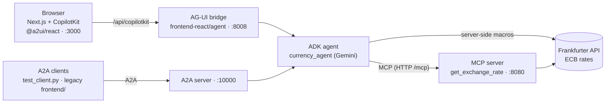

# 💵💱💶 Currency Agent: ADK + MCP + A2UI 1.0 over AG-UI and A2A

[![Open In Codelab][codelab-badge]][codelab]
[](https://www.python.org/)
[](https://github.com/google/adk-python)
[](https://a2ui.org)
[](LICENSE)

[codelab-badge]: https://img.shields.io/badge/Open%20In%20Codelab-blue?labelColor=grey&style=flat
[codelab]: https://codelabs.developers.google.com/codelabs/currency-agent

A currency conversion agent that answers with generated UI. Ask "How much is 250 USD in EUR?" and the agent replies with a rate card; ask for a trend and it draws a line chart. The agent runs on Google's [Agent Development Kit](https://github.com/google/adk-python) with Gemini, gets exchange rates from an [MCP](https://modelcontextprotocol.io) tool server, and describes its UI in [A2UI 1.0](https://a2ui.org). A Next.js + [CopilotKit](https://www.copilotkit.ai) front end renders it over [AG-UI](https://docs.ag-ui.com), and the same agent is also served over [A2A](https://github.com/a2aproject/A2A).

Builds on the [Currency Agent codelab](https://codelabs.developers.google.com/codelabs/currency-agent) (A2A + ADK + MCP).

---

#### Architecture



| Service | Port | Code |
|---|---|---|
| MCP server: `get_exchange_rate` tool (FastMCP) | 8080, path `/mcp` | `mcp-server/` |
| A2A server: the ADK agent over A2A, `/health` | 10000 | `currency_agent/` |
| AG-UI bridge: the same agent in-process, `/health` | 8008 | `frontend-react/agent/` |
| React UI: Next.js 16, CopilotKit 1.56, `@a2ui/react` | 3000 | `frontend-react/` |
| Legacy UI: FastAPI + Vite, talks A2A | 8000 | `frontend/` |

---

#### How the UI is generated (A2UI 1.0)

Libraries: `a2ui-agent-sdk` 0.11.0, `a2ui-adk` 0.3.0 and `a2ui-core` 0.6.0 on the agent; `@a2ui/react` 0.15.0 and `@a2ui/web_core/v1_0` in the React UI.

- **Express inference format.** The model writes compact `<a2ui>` blocks. `A2uiRequestProcessor` compiles and validates them into v1.0 messages (`createSurface` with embedded components and `{"@path": ...}` bindings).
- **Server-side macros** (`currency_agent/macros.py`). `RateCard(from, to, amount)` and `RateHistoryChart(from, to, days)` are components the model calls in one line. `MacroExpander` runs them on the agent, where they fetch rates from the Frankfurter API and expand into Basic catalog `Card`/`Column`/`Text` plus the custom `LineChart`. The rate figures never pass through the model's context, and the macros accept only three-letter currency codes and a clamped day range.
- **Two validation passes.** The payload is checked against the inference catalogs (Basic + charts + macro definitions), then again after expansion against the catalogs the renderer implements (Basic 1.0 + charts).
- **Custom catalog** (`currency_agent/custom_catalog.json`, `protocolVersion: "1.0"`) adds `LineChart` and `BarChart`. Its catalog id must match `frontend-react/src/components/A2UICustomCatalog.tsx`.
- **React renderer.** Results of the `send_a2ui_json_to_client` tool are rendered by `@a2ui/react` with a per-turn `MessageProcessor` (`frontend-react/src/components/A2uiMessages.tsx`). CopilotKit's built-in A2UI middleware speaks v0.9, so it is turned off.

Measured with `gemini-2.5-flash` on 2026-11-11, one run each:

| Question | Model output | Output tokens | Rendered |
|---|---|---|---|
| How much is 250 USD in EUR? | `root = RateCard(currency_from="USD", currency_to="EUR", amount=250, ...)` | 77 | Card: 250.00 USD = 224.68 EUR |
| USD to JPY trend, last 30 days | `root = RateHistoryChart("USD", "JPY", 30, ...)` | 70 | Card with a 30-day line chart |

The legacy `frontend/` talks to the A2A server. Its renderer was written for A2UI before 1.0 and has not been tested against 1.0 messages.

---

#### Getting Started

**Prerequisites:** Python 3.13+, Node.js and npm, and [uv](https://docs.astral.sh/uv/getting-started/installation) (the Makefile uses it).

```bash
git clone https://github.com/xbill9/currency-claude-agui-a2ui1.git
cd currency-claude-agui-a2ui1
make install    # uv sync + npm install for both front ends
```

**Configure Gemini** in a `.env` file at the repo root. Either a Google AI Studio key ([get one](https://aistudio.google.com/apikey)):

```sh
echo "GOOGLE_API_KEY=<your_api_key_here>" >> .env
echo "GOOGLE_GENAI_USE_VERTEXAI=FALSE" >> .env
```

or Vertex AI on a Google Cloud project with `aiplatform.googleapis.com` enabled:

```sh
echo "GOOGLE_GENAI_USE_VERTEXAI=TRUE" >> .env
echo "GOOGLE_CLOUD_PROJECT=<your_project_id>" >> .env
echo "GOOGLE_CLOUD_LOCATION=us-central1" >> .env
```

The agent uses `gemini-2.5-flash` unless `GENAI_MODEL` is set in `.env`.

---

#### Running locally

```bash
make start     # MCP server, A2A server, AG-UI bridge and React UI in the background
make status    # which services are up, and on which ports
make stop
```

Then open http://localhost:3000. Logs go to `mcp.log`, `agent.log`, `react-agent.log` and `react-ui.log`.

To run services in separate terminals instead: `make mcp`, `make agent`, `make react-agent`, `make react-ui`. The legacy UI: `make frontend-build && make frontend`, then http://localhost:8000.

**Without uv**, if the dependencies are installed in your active Python:

```bash
python3 mcp-server/server.py
python3 -m uvicorn currency_agent.agent:a2a_app --host 127.0.0.1 --port 10000
(cd frontend-react/agent && python3 main.py)
(cd frontend-react && npm run dev:ui)
```

---

#### Testing

| Command | What it checks |
|---|---|
| `make test-agui` | AG-UI / CopilotKit endpoints, streaming, A2UI responses and guardrails (needs services running) |
| `make react-test` | Starts everything, runs the React UI + agent end-to-end test, stops |
| `make test` | Starts everything, runs pytest (MCP server tests and legacy UI tests), stops |
| `make frontend-test` | Legacy UI unit tests |
| `make test-client` | Sends sample questions to the A2A server |
| `make lint` / `make format` | Ruff check and format |

---

#### Deploying to Cloud Run

```bash
make deploy    # gcloud builds submit --config cloudbuild.yaml .
```

`cloudbuild.yaml` builds and deploys two services in `us-central1`: `currency-mcp` (the MCP server) and `currency-agent` (the A2A server on Vertex AI, pointed at the MCP service). `make endpoint`, `make logs` and `make remote-status` inspect the deployed agent. `frontend-react/Dockerfile` packages the React UI and AG-UI bridge as one container.

---

#### Contributing

Issues and pull requests are welcome.

#### License

Apache 2.0. See [LICENSE](LICENSE).
