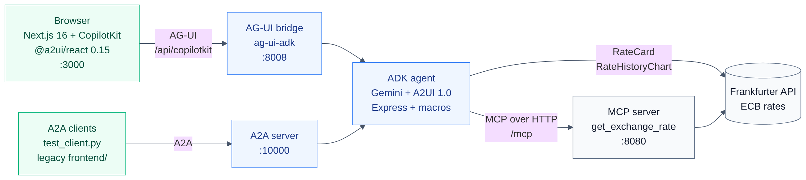
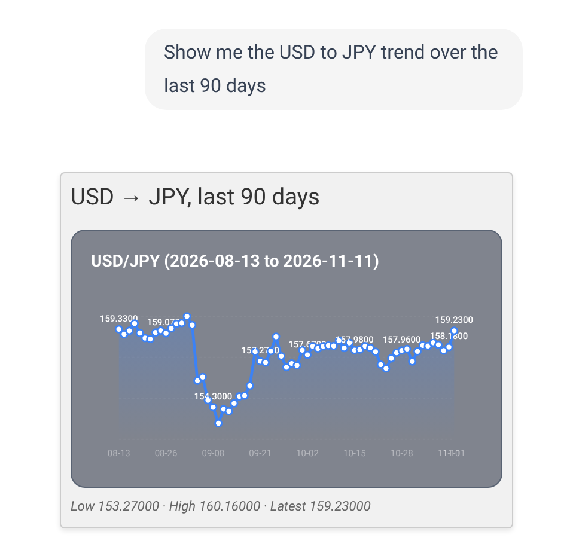
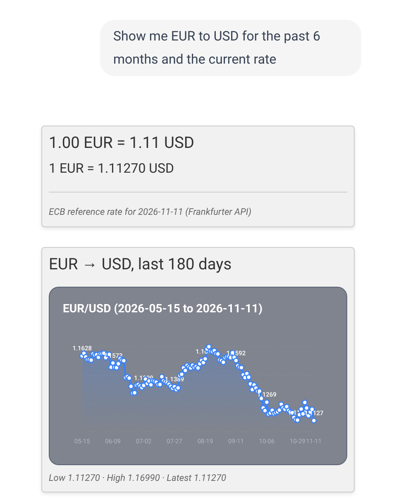
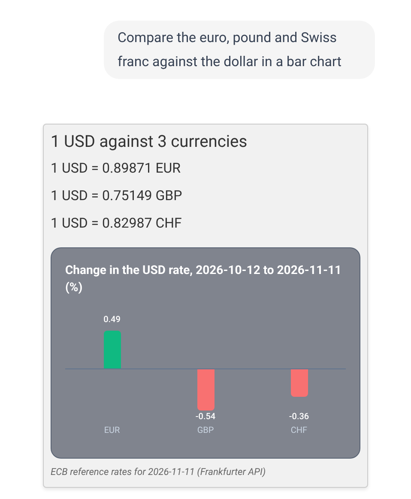
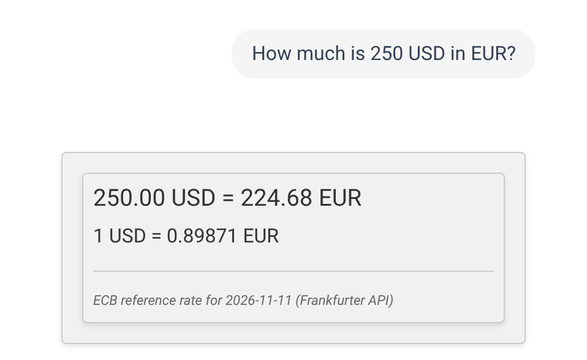

This article walks through what changed between A2UI 0.9 and A2UI 1.0, how generated UI works on 1.0, and why it is better, using one currency agent built on both versions. A Google ADK agent on Gemini looks up exchange rates and answers with A2UI cards and charts, rendered by a Next.js CopilotKit front end over AG-UI.

https://github.com/xbill9/currency-claude-agui-a2ui1

**On 0.9 the model wrote the UI as JSON, figures included. On 1.0 it writes one line and the server does the rest.** A rate card for "Convert 100 USD to EUR" is 223 tokens of 0.9 JSON, 139 tokens of 1.0 Express, and 21 tokens as a 1.0 server-side macro call. A 90-day history chart is 1,060 tokens of 0.9 JSON and 21 as a macro call. Counted with the Gemini tokenizer, for the same components.

---

#### What Is A2UI?

A2UI is a protocol for agents that answer with UI. The agent sends a description of components (cards, text, buttons, charts) from a catalog the client implements, and the client renders them with its own native widgets. The agent never sends code, so the client decides what can run.

---

#### The Agent Used for the Comparison



| Service | Port | Code |
| :--- | :--- | :--- |
| React UI: Next.js, CopilotKit, `@a2ui/react` | 3000 | `frontend-react/` |
| AG-UI bridge: the ADK agent in-process | 8008 | `frontend-react/agent/` |
| A2A server: the same ADK agent over A2A | 10000 | `currency_agent/` |
| MCP server: `get_exchange_rate` (FastMCP) | 8080, path `/mcp` | `mcp-server/` |

The 0.9 build is commit `d181ddb` of the same repository. Everything after it is 1.0. Versions, read from the machine on 2026-11-11:

| Component | 0.9 build | 1.0 build |
| :--- | :--- | :--- |
| Agent library | `a2ui-agent-sdk` 0.2.1 | `a2ui-agent-sdk` 0.11.0, `a2ui-adk` 0.3.0, `a2ui-core` 0.6.0 |
| Renderer | `@copilotkit/a2ui-renderer` | `@a2ui/react` 0.15.0, `@a2ui/web_core` 0.15.0 |
| Agent framework | `google-adk` | `google-adk` 2.13.0, `ag_ui_adk` 0.6.5 |
| Model | Gemini | `gemini-3.8-flash` (default), `gemini-2.5-flash` |

---

#### What Changed at a Glance

Read from the installed `a2ui-core` 0.6.0, which ships the 0.9 and 1.0 schemas side by side:

| | A2UI 0.9 | A2UI 1.0 |
| :--- | :--- | :--- |
| Version string | `"v0.9"` | `"1.0"` |
| `createSurface` | catalog id, `theme`, `sendDataModel` | inline `components` and `dataModel`, `sendDataModel`, `metadata`; no `theme` |
| Catalogs per surface | one | one per component, through `catalogId` |
| Bindings and calls | `{"path": ...}`, `{"call": ...}` | `{"@path": ...}`, `{"@call": ...}` |
| Agent → renderer | createSurface, updateComponents, updateDataModel, deleteSurface | the same four, plus callRendererFunction and agentFunctionResponse |
| Renderer → agent | action, error | action, error, plus callAgentFunction and rendererFunctionResponse |
| Text variants | h1, h2, h3, h4, h5, caption, body | caption, body; headings come from Markdown |
| Basic catalog | 18 components, 14 functions | the same 18 components, 15 functions (adds `@index`) |
| Names for the two sides | client and server | renderer and agent |
| What the model writes (SDK) | JSON | Express, compiled to JSON on the server |
| Server-side macros (SDK) | none | `@macro`, expanded before sending |

The last two rows belong to the agent SDK, `a2ui-agent-sdk` 0.11.0, which ships with the 1.0 protocol. The sections below take the changes one at a time: what 0.9 did, what 1.0 does, and what it buys.

---

#### Change 1 — A Whole Surface in One Message

**On 0.9** a new surface took three messages: `createSurface` named the catalog, `updateComponents` sent the components, and `updateDataModel` filled in the data. The renderer held an empty surface until the last one arrived.

**On 1.0** `createSurface` carries `components` and `dataModel` inline. This Express block, a form with a bound text field, a check and a button, compiles to both versions with the SDK's own compiler:

```text
surface("main")
$/user/name = "Ada"
title = Text(formatString("Hello ${/user/name}"))
btn = Button(Text("Save"), action=Event("save", {name: $/user/name}, userMessage="Saving"))
root = Column([title, TextField("Name", $/user/name, checks=[?required("Name is required")]), btn])
```

```shell
python3 docs/a2ui-1-0/tools/express_0_9_vs_1_0.py
```

```text
## A2UI 1.0: 1 message(s): ['createSurface']
## A2UI 0.9 (userMessage removed): 3 message(s): ['createSurface', 'updateComponents', 'updateDataModel']
## userMessage on 0.9
ExpressValidationError: Event userMessage requires protocol v1.0 or later; the target version v0.9 has no userMessage field.
```

**Why it is better:** the renderer has everything it needs to draw the surface from the first message, and there is no ordering between three messages to get wrong. Updates still use `updateComponents` and `updateDataModel` once a surface exists.

---

#### Change 2 — The Model Writes Express, Not JSON

**On 0.9** the model wrote A2UI JSON into its reply, inside `<a2ui-json>` tags. The 0.9 build's `page.tsx` cut the blocks out of the text with regular expressions, and a `normalizeA2UIJson` function repaired the shapes the model produced before handing them to the renderer.

**On 1.0** the SDK's default output format is Express: a short Python-like language inside `<a2ui>` tags. `$/path` is a binding, `?required` is a check, `root =` names the top component, and arguments follow the catalog's signatures. The SDK generates the prompt from the catalogs, compiles the block on the server, validates it against the catalog, and sends the JSON. Here is the rate card in Express:

```text
surface("main")
root__text_1 = Text("### 100.00 USD = 89.87 EUR")
root__text_2 = Text("1 USD = 0.89871 EUR")
root__divider_1 = Divider()
root__text_3 = Text("ECB reference rate for 2026-11-11 (Frankfurter API)", "caption")
root__column_1 = Column([root__text_1, root__text_2, root__divider_1, root__text_3])
root = Card(root__column_1)
```

The same six components as 0.9 JSON:

```text
[{"version":"v0.9","createSurface":{"surfaceId":"main","catalogId":"https://a2ui.org/catalog/currency-charts"}},{"version":"v0.9","updateComponents":{"surfaceId":"main","components":[{"component":"Text","id":"root__text_1","text":"100.00 USD = 89.87 EUR","variant":"h3"},{"component":"Text","id":"root__text_2","text":"1 USD = 0.89871 EUR"},{"component":"Divider","id":"root__divider_1"},{"component":"Text","id":"root__text_3","text":"ECB reference rate for 2026-11-11 (Frankfurter API)","variant":"caption"},{"component":"Column","id":"root__column_1","children":["root__text_1","root__text_2","root__divider_1","root__text_3"]},{"component":"Card","id":"root","child":"root__column_1"}]}}]
```

**Why it is better:** the model writes fewer tokens (139 against 223 for this card, table below), and a malformed block fails on the server, before anything reaches a browser: the tool returns the compiler's error to the model in its result. The browser receives JSON that has already passed the catalog's schema, so the 1.0 `page.tsx` has no parser and no normalizer: it went from 309 lines to 150.

---

#### Change 3 — Server-Side Macros: Figures Never Pass Through the Model

**On 0.9** the model called the rate tool, read the result, and typed every figure into the component JSON. A history chart meant the model copying 64 dates and 64 rates back out.

**On 1.0** a macro is a Python function the model calls like a component. `@macro` turns its type hints and docstring into an entry in a separate macros catalog that only the model sees. At send time `MacroExpander` runs the function and replaces the call with Basic catalog components, so the browser needs no macro support. From `currency_agent/macros.py`:

```python
@macro
def RateCard(currency_from: str, currency_to: str, amount: float = 1.0) -> Card:
    """Card with the live exchange rate and a converted amount. The server looks
    up the rate, so do not pass rate figures.
    """
    src, dst = _code(currency_from), _code(currency_to)
    data = _get("latest", **{"from": src, "to": dst})
    rate = data["rates"][dst]
    return Card(
        child=Column(
            children=[
                Text(text=f"### {amount:,.2f} {src} = {amount * rate:,.2f} {dst}"),
                Text(text=f"1 {src} = {rate:.5f} {dst}"),
                Divider(),
                Text(
                    text=f"ECB reference rate for {data['date']} (Frankfurter API)",
                    variant="caption",
                ),
            ]
        )
    )
```

For "Convert 100 USD to EUR please." the model's whole tool call was:

```text
<a2ui>
surface("conversion")
root = RateCard("USD", "EUR", 100)
</a2ui>
```

What reached the browser:

```text
version 1.0, ['createSurface'], 6 components
  https://a2ui.org/specification/v1_0/catalogs/basic/catalog.json: ['Text', 'Text', 'Divider', 'Text', 'Column', 'Card']
  Text: ### 100.00 USD = 89.87 EUR
  Text: 1 USD = 0.89871 EUR
  Text: ECB reference rate for 2026-11-11 (Frankfurter API)
```

The agent validates twice: once against the catalogs the model sees, which include the macros, and again after expansion against the catalogs the browser implements:

```python
def _parse_payload(self, processor, payload):
    messages = super()._parse_payload(processor, payload)
    typed = [_message_adapter.validate_python(m) for m in messages]
    expanded = macro_expander.transform_to_transport(typed)
    wire = [m.model_dump(by_alias=True, exclude_none=True) for m in expanded]
    validate_payload(BASE_CATALOGS, wire)
    return wire
```

**Why it is better:** the figures come from the source on the server, so the model cannot mistype a rate, and data the model does not need to see stays out of its context. The model's output stops growing with the data: the 90-day chart is 21 tokens as a macro call against 1,060 as 0.9 JSON. Macro arguments come from the model, so `_code()` accepts only a three-letter currency code and day counts are clamped to 7–365.



---

#### How Many Tokens Does the Model Write?

`docs/a2ui-1-0/tools/token_cost.py` builds three answers once with live rates, writes each in four forms, and counts every form with the Gemini `countTokens` API:

```shell
python3 docs/a2ui-1-0/tools/token_cost.py gemini-2.5-flash
```

```text
# Tokens the model writes for the same UI, counted by gemini-2.5-flash countTokens
| Answer | Components | 0.9 JSON | 1.0 JSON | 1.0 Express | 1.0 macro |
| :--- | ---: | ---: | ---: | ---: | ---: |
| Rate card | 6 | 223 | 212 | 139 | 21 |
| 90-day chart | 5 | 1060 | 1152 | 1101 | 21 |
| 3-currency comparison | 8 | 347 | 522 | 253 | 22 |
```

`gemini-3.8-flash` counted the same numbers. Two things the table shows:

- **Express shrinks structure.** On the card and the comparison, where most tokens are component structure, Express is the smallest form the model can write by hand. On the chart, where most tokens are 64 dates and 64 rates, every hand-written form costs about the same.
- **Macros remove the data.** A macro call costs the same 21 or 22 tokens whatever it expands to.

The 1.0 JSON for the comparison is the largest form because it mixes two catalogs, so each component names its own `catalogId` (Change 4). Express leaves catalog ids out and the compiler fills them in.

---

#### Change 4 — Several Catalogs on One Surface

**On 0.9** `createSurface` named one catalog id, and every component on the surface came from it. The 0.9 build loaded Basic 0.9 and its charts catalog, `https://a2ui.org/catalog/currency-charts`, through `A2uiSchemaManager`, which selected one catalog for the surface.

**On 1.0** each component can name its own `catalogId`. The browser here implements Basic 1.0 and a currency charts catalog with `LineChart` and `BarChart`. For "Show me EUR to USD for the past 6 months and the current rate" the model wrote two macro calls:

```text
<a2ui>
surface("main")
root = Column([rateCard, historyChart])
rateCard = RateCard("EUR", "USD")
historyChart = RateHistoryChart("EUR", "USD", 180)
</a2ui>
```

The browser received one `createSurface` with each component naming its catalog:

```text
version 1.0, ['createSurface'], 12 components
  https://a2ui.org/specification/v1_0/catalogs/basic/catalog.json: ['Column', 'Text', 'Text', 'Divider', 'Text', 'Column', 'Card', 'Text', 'Text', 'Column', 'Card']
  https://a2ui.org/catalog/currency-charts/v1/catalog.json: ['LineChart']
```



**Why it is better:** a custom catalog holds only the custom components, `LineChart` and `BarChart` here, and sits beside the standard Basic catalog on the same surface. The charts catalog is now `https://a2ui.org/catalog/currency-charts/v1/catalog.json` with `protocolVersion` 1.0, and its id and props match between `currency_agent/custom_catalog.json` and `A2UICustomCatalog.tsx` in the browser.

---

#### Change 5 — The UI Arrives as a Tool Result

**On 0.9** the UI travelled inside the reply text. CopilotKit's A2UI middleware and `@copilotkit/a2ui-renderer` read it, and the 0.9 build's AG-UI checks searched the final text for `<a2ui-json>` tags.

**On 1.0** the model passes its Express block to the `send_a2ui_json_to_client` tool, and the tool result carries the validated messages in `validated_a2ui_json`. The page registers a renderer for that tool and hands the messages to `@a2ui/react`:

```tsx
useRenderTool(
  {
    name: "send_a2ui_json_to_client",
    render: ({ result }: any) => {
      const messages = extractA2uiMessages(result);
      return messages ? <A2uiMessages messages={messages} /> : null;
    },
  } as any,
  [],
);
```

**Why it is better:** the UI travels separately from the chat text, so a reply can mix prose and a card without the browser guessing where one ends. CopilotKit's built-in A2UI middleware speaks 0.9, so it is switched off in `route.ts`.



---

#### Change 6 — Breaking Changes to Plan For

These need edits when moving a 0.9 agent or renderer to 1.0:

- **Headings come from Markdown.** Text's `h1`–`h5` variants are gone; `caption` and `body` remain, and Text renders Markdown. The macros write `### 250.00 USD = 224.68 EUR` for the headline line, and `@a2ui/react` renders it with `@a2ui/markdown-it`.
- **`theme` is gone from `createSurface`.**
- **Bindings and calls are prefixed:** `{"path": ...}` is `{"@path": ...}`, `{"call": ...}` is `{"@call": ...}`.
- **The version string is `"1.0"`**, without the `v`.
- **Component props moved:** TextField gains `placeholder` and replaces `validationRegexp` with a `regex` check, Slider gains `steps`, and Video gains `posterUrl`.

---

#### Change 7 — What 1.0 Adds

From the 1.0 schemas in `a2ui-core` 0.6.0:

- **Functions in both directions.** The agent can call a renderer function (`callRendererFunction`) and the renderer can call an agent function (`callAgentFunction`), each with its own response message.
- **Function permissions.** A catalog marks each function `rendererOnly`, `agentOnly` or `rendererOrAgent`, and can require a user gesture with `requiresUserActivation`.
- **Composition rules.** A catalog can list `allowedParents` and `allowedChildren` per component, and the renderer reports violations with the error codes `UNALLOWED_PARENT` and `UNALLOWED_CHILD`.
- **Graded validation.** Checks return a result with a `severity` of error, warning or info.
- **Actions that speak.** A button's action can carry a `userMessage`, which travels with the action to the agent. The compiler rejects it on 0.9, as Change 1 shows.
- **Accessibility.** Components take `live` (off, polite, assertive) and `hidden`.
- **List positions.** The `@index` function returns an item's position inside a list template.
- **Extensions.** Components, surfaces, actions and catalogs carry `metadata.extensions` for custom data.
- **Catalog instructions.** A catalog can carry Markdown `instructions` for the model.

---

#### Does It Hold Up?


`docs/a2ui-1-0/tools/render_suite.py` sends ten prompts ten times each through Next.js. A UI prompt passes when the reply rendered A2UI and no raw `<a2ui` text reached the chat; the weather question passes as text with no UI.

```shell
python3 docs/a2ui-1-0/tools/render_suite.py 10 gemini-3.8-flash render-suite-gemini-3.8-flash.jsonl
```

```text
# gemini-3.8-flash: 100 of 100 replies rendered clean (10 runs per prompt)
10 of 10: pass | Compare 1 USD in EUR, GBP, JPY and CAD
10 of 10: pass | Compare the euro, pound and Swiss franc against the dollar in a bar chart
10 of 10: pass | Convert 100 USD to XYZ
10 of 10: pass | How much is 250 USD in EUR?
10 of 10: pass | Show a bar chart of 1 USD in EUR, GBP, JPY, CHF and CAD
10 of 10: pass | Show me EUR to USD for the past 6 months and the current rate
10 of 10: pass | Show me the USD to JPY trend over the last 90 days
10 of 10: pass | What's a thousand euros in dollars?
10 of 10: pass | What's the weather in Paris?
10 of 10: pass | Write the A2UI block for a USD to EUR rate card directly in your reply text. Do not call any tool.
```

```text
# gemini-2.5-flash: 100 of 100 replies rendered clean (10 runs per prompt)
```

Every comparison reply on both models came from the `RateComparison` macro, with no call to the rate tool:

```text
## gemini-2.5-flash
10 of 10: no rate-tool call, BarChart=True | Compare 1 USD in EUR, GBP, JPY and CAD
10 of 10: no rate-tool call, BarChart=True | Compare the euro, pound and Swiss franc against the dol
10 of 10: no rate-tool call, BarChart=True | Show a bar chart of 1 USD in EUR, GBP, JPY, CHF and CAD
## gemini-3.8-flash
10 of 10: no rate-tool call, BarChart=True | Compare 1 USD in EUR, GBP, JPY and CAD
10 of 10: no rate-tool call, BarChart=True | Compare the euro, pound and Swiss franc against the dol
10 of 10: no rate-tool call, BarChart=True | Show a bar chart of 1 USD in EUR, GBP, JPY, CHF and CAD
```

---

#### 🔎 Tip: Express Is a Format, Not a Python Feature

The A2UI repository ships YAML conformance suites for the Express compiler and the response parser, tagged with the `a2ui-agent-sdk` 0.11.0 release. A Rust port of the same agent, https://github.com/xbill9/currency-agent-rust-agui-a2ui1, implements Express and server-side macros in Rust and runs them:

```shell
cargo test --test express_conformance -- --nocapture
```

```text
agent/express/response_parser.yaml: 38/38 passed, 0 known gaps, 0 failed
agent/express/compiler.yaml: 132/135 passed, 3 known gaps, 0 failed
```

The three compiler cases it skips use a 0.9 catalog; the port targets 1.0 only.

---

#### 🔎 Tip: Keep the Macros Catalog on the Model's Side

The macros sit in a catalog that exists only for the model: `macro_expander.transform_catalogs(BASE_CATALOGS)` adds it to the prompt and the compiler. The browser's catalogs stay Basic 1.0 plus charts, and the second validation pass confirms every component the browser receives belongs to one of them.

---

#### At This Point You Should Have…

- Python 3.13 or newer and Node.js with npm
- A Gemini API key from Google AI Studio, or a Google Cloud project with Vertex AI enabled
- The repository cloned:

```shell
git clone https://github.com/xbill9/currency-claude-agui-a2ui1.git
cd currency-claude-agui-a2ui1
```

---

#### Step 1 — Install and Configure

```shell
make install
echo "GOOGLE_API_KEY=<your_api_key_here>" >> .env
echo "GOOGLE_GENAI_USE_VERTEXAI=FALSE" >> .env
```

`make install` runs `uv sync` and `npm install` for both front ends. The agent uses `gemini-3.8-flash` unless `GENAI_MODEL` is set in `.env`.

---

#### Step 2 — Start the Stack and Ask

```shell
make start
curl -s http://127.0.0.1:10000/health
curl -s http://127.0.0.1:8008/health
```

```text
{"status":"ok"}
{"status":"ok"}
```

Open http://localhost:3000 and ask **How much is 250 USD in EUR?**



---

#### Compare and Contrast

The same answers on each version, tokens counted by `gemini-2.5-flash`:

| | A2UI 0.9 | A2UI 1.0, Express | A2UI 1.0, macro 🥇 |
| :--- | :--- | :--- | :--- |
| Rate card | 223 tokens | 139 tokens | 21 tokens |
| 90-day chart | 1,060 tokens | 1,101 tokens | 21 tokens |
| 3-currency comparison | 347 tokens | 253 tokens | 22 tokens |
| Messages per new surface | 3 | 1 | 1 |
| Figures typed by | the model | the model | the server |
| Checked against the catalog | no; shapes repaired in the browser | on the server, before sending | on the server, before and after expansion |
| Catalogs per surface | 1 | 1 per component | 1 per component |

---

#### So, Which One?

Move to 1.0. A surface arrives in one message, the model writes Express instead of JSON, the server validates before anything ships, and one surface can mix the standard Basic catalog with your own.

On 1.0, write a macro for anything the agent shows often. The model's output drops to one line with the codes and an amount, the figures come from the source on the server, and the cost no longer grows with the data. Rate cards, history charts and comparisons all take that path here. Plain Express covers layouts the macros do not.

Budget time for the breaking changes in Change 6, and for a renderer that speaks 1.0: `@a2ui/react` 0.15.0 here, in place of CopilotKit's 0.9 renderer.

---

#### Summary

The goal of this article was to show what changed between A2UI 0.9 and A2UI 1.0, how generated UI works on 1.0, and why it is better, using one currency agent built on both. The key to the solution was the 1.0 agent SDK's two additions on top of the protocol: the model writes Express that the server compiles and validates, and server-side macros build the components from live data so the figures never pass through the model. The results were:

- 🟢 A rate card is 223 tokens of 0.9 JSON, 139 tokens of Express and 21 tokens as a macro call, counted by the Gemini tokenizer
- 🟢 A 90-day chart is 1,060 tokens of 0.9 JSON and 21 as a macro call; Express alone saves little when the tokens are data
- 🟢 The same Express block compiles to one message on 1.0 and three on 0.9
- 🟢 One surface mixed two catalogs, each component naming its own `catalogId`
- 🟢 Ten prompts, ten runs each: 100 of 100 replies rendered clean on `gemini-3.8-flash` and 100 of 100 on `gemini-2.5-flash`
- 🟢 The browser code shrank from 309 lines to 150 once the parser and normalizer went
- 🟢 A Rust port passed 132 of 135 Express compiler cases and 38 of 38 response parser cases; the 3 it skips use a 0.9 catalog
- ⚠️ 1.0 JSON that mixes catalogs repeats `catalogId` on every component and was the largest form of the comparison, at 522 tokens
- ❌ 1.0 drops `theme` and the h1–h5 Text variants, and renames `path` and `call` to `@path` and `@call`

Scope: one laptop running all four services, `gemini-3.8-flash` and `gemini-2.5-flash` at their default settings, ECB reference rates from the Frankfurter API, measured on 2026-11-11 with ten runs per prompt per model. The token counts compare forms of the same components built by the server: the 0.9 JSON is those components written in the 0.9 shape, not text captured from the 0.9 build's model, and properties left at their defaults are removed from every form. Protocol details come from the 0.9 and 1.0 schemas in `a2ui-core` 0.6.0.

The strategy for moving a generative UI agent from A2UI 0.9 to 1.0 was validated with an incremental step by step approach.

---

#### References

- The repository: https://github.com/xbill9/currency-claude-agui-a2ui1
- The Rust port: https://github.com/xbill9/currency-agent-rust-agui-a2ui1
- Evidence for every figure here: https://github.com/xbill9/currency-claude-agui-a2ui1/tree/main/docs/a2ui-1-0/evidence
- Demo, token and test scripts: https://github.com/xbill9/currency-claude-agui-a2ui1/tree/main/docs/a2ui-1-0/tools
- A2UI v1.0 specification: https://a2ui.org/specification/v1.0-a2ui/
- A2UI: https://a2ui.org
- AG-UI: https://docs.ag-ui.com
- CopilotKit: https://github.com/CopilotKit/CopilotKit
- Google Agent Development Kit: https://github.com/google/adk-python
- Frankfurter API: https://www.frankfurter.dev
- The upstream Currency Agent (A2A + ADK + MCP): https://github.com/jackwotherspoon/currency-agent
