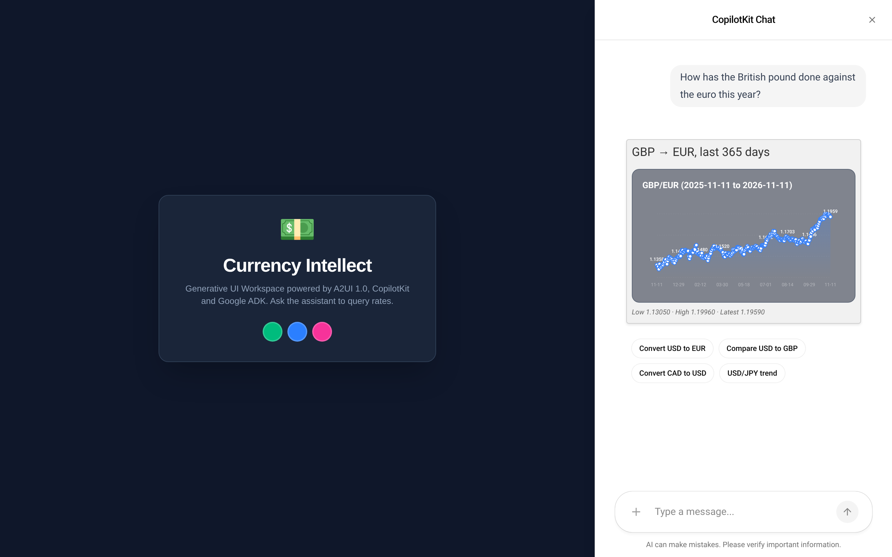
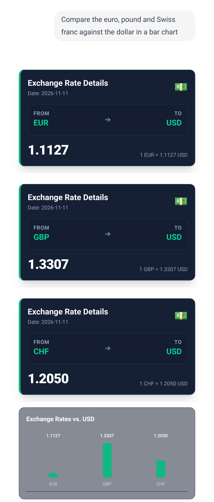
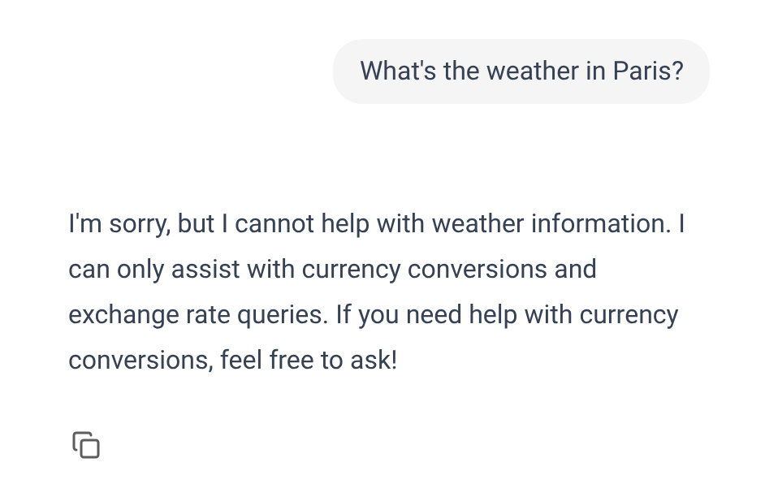

This article provides a step by step guide to a currency agent that answers with generated UI on A2UI 1.0. A Google ADK agent on Gemini looks up exchange rates, describes its answer as A2UI components, and a Next.js CopilotKit front end renders the cards and charts over AG-UI. The same agent also serves A2A.

https://github.com/xbill9/currency-claude-agui-a2ui1

**On A2UI 1.0 the model writes one line, and the server fills in the numbers.** For "Convert 100 USD to EUR" the model's whole output is `root = RateCard("USD", "EUR", 100)`. A server-side macro fetches the rate from the Frankfurter API and expands that line into six Basic catalog components. On A2UI 0.9 the model called the rate tool, read the result, and typed every figure into the component JSON itself. The four macro prompts below rendered a UI in 5 of 5 runs each and never called the rate tool.

---

#### What Is Being Built?


| Service | Port | Code |
| :--- | :--- | :--- |
| React UI: Next.js, CopilotKit, `@a2ui/react` | 3000 | `frontend-react/` |
| AG-UI bridge: the ADK agent in-process | 8008 | `frontend-react/agent/` |
| A2A server: the same ADK agent over A2A | 10000 | `currency_agent/` |
| MCP server: `get_exchange_rate` (FastMCP) | 8080, path `/mcp` | `mcp-server/` |

The browser path is the main one: Next.js forwards `/api/copilotkit` to the AG-UI bridge, which imports the ADK agent and streams AG-UI events back. The A2A server runs the same agent object for A2A clients and is what Cloud Build deploys to Cloud Run.

Versions, read from the machine on 2026-11-11:

| Component | Version |
| :--- | :--- |
| `a2ui-agent-sdk` / `a2ui-adk` / `a2ui-core` | 0.11.0 / 0.3.0 / 0.6.0 |
| `@a2ui/react` / `@a2ui/web_core` | 0.15.0 / 0.15.0 |
| `google-adk` / `ag_ui_adk` / `a2a-sdk` | 2.13.0 / 0.6.5 / 0.3.26 |
| `next` / `react` / `@copilotkit/react-core` | 16.1.1 / 19.2.7 / 1.56.4 |
| Python / Node | 3.14.7 / v24.21.0 |
| Model | `gemini-2.5-flash` |

---

#### What Changed From A2UI 0.9?


| | A2UI 0.9 | A2UI 1.0 |
| :--- | :--- | :--- |
| Model output | Full component JSON, figures included | Express `<a2ui>` block, often one macro call |
| Rate figures | Typed by the model from the MCP result | Fetched by the macro on the server |
| How the UI travels | `<a2ui-json>` blocks in the reply text | `validated_a2ui_json` in the tool result |
| Validation | Browser normalizer accepts several shapes | Server validates before and after macro expansion |
| Renderer | `@copilotkit/a2ui-renderer` and CopilotKit's A2UI middleware | `@a2ui/react` 0.15.0; the middleware stays off |
| Components | Card, Text, Table, BarChart, LineChart | Basic 1.0 (18 components) plus BarChart, LineChart |
| Agent library | `a2ui-agent-sdk` 0.2.1, `A2uiSchemaManager(version="0.9")` | `a2ui-agent-sdk` 0.11.0, `a2ui-adk`, `a2ui-core` |
| `page.tsx` | 309 lines | 150 lines |

Basic 1.0 has no Table component. Tabular answers become rows and columns, or a bar chart.

---

#### At This Point You Should Have…

- Python 3.13 or newer and Node.js with npm
- A Gemini API key from Google AI Studio, or a Google Cloud project with Vertex AI enabled
- The repository cloned:

```shell
git clone https://github.com/xbill9/currency-claude-agui-a2ui1.git
cd currency-claude-agui-a2ui1
```

---

#### Step 1 — Install and Configure

```shell
make install
echo "GOOGLE_API_KEY=<your_api_key_here>" >> .env
echo "GOOGLE_GENAI_USE_VERTEXAI=FALSE" >> .env
```

`make install` runs `uv sync` and `npm install` for both front ends. The agent uses `gemini-2.5-flash` unless `GENAI_MODEL` is set in `.env`.

---

#### Step 2 — Start the Stack

```shell
make start
curl -s http://127.0.0.1:10000/health
curl -s http://127.0.0.1:8008/health
```

```text
{"status":"ok"}
{"status":"ok"}
```

`make start` launches the MCP server, the A2A server, the AG-UI bridge and the Next.js dev server in the background, with logs in `mcp.log`, `agent.log`, `react-agent.log` and `react-ui.log`. The UI is at http://localhost:3000.

---

#### Step 3 — The Model Writes One Line

The macros live in `currency_agent/macros.py`. Each one is a Python function the model calls by name; the docstring becomes the model's description of it:

```python
@macro
def RateCard(currency_from: str, currency_to: str, amount: float = 1.0) -> Card:
    """Card with the live exchange rate and a converted amount. The server looks
    up the rate, so do not pass rate figures.
    """
    src, dst = _code(currency_from), _code(currency_to)
    data = _get("latest", **{"from": src, "to": dst})
    rate = data["rates"][dst]
    return Card(
        child=Column(
            children=[
                Text(text=f"### {amount:,.2f} {src} = {amount * rate:,.2f} {dst}"),
                Text(text=f"1 {src} = {rate:.5f} {dst}"),
                Divider(),
                Text(
                    text=f"ECB reference rate for {data['date']} (Frankfurter API)",
                    variant="caption",
                ),
            ]
        )
    )
```

`_code()` accepts only a three-letter currency code, and `RateHistoryChart` clamps its day count to 7–365, because the arguments come from the model.

For "Convert 100 USD to EUR please." the model's entire tool call was:

```json
{"a2ui_payload": "<a2ui>\nroot = RateCard(\"USD\", \"EUR\", 100, catalogId=\"https://a2ui.org/catalogs/macros\")\n</a2ui>"}
```

The tool result that reached the browser, trimmed to the text:

```text
version 1.0, createSurface, 6 components: Text, Text, Divider, Text, Column, Card
"### 100.00 USD = 89.87 EUR"
"1 USD = 0.89871 EUR"
"ECB reference rate for 2026-11-11 (Frankfurter API)"
```

The agent wires this up in `currency_agent/agent.py`. The tool compiles the Express block and validates it against the catalogs the model sees, which include the macros. The subclass then expands the macros and validates the result against the catalogs the browser implements:

```python
def _parse_payload(self, processor, payload):
    messages = super()._parse_payload(processor, payload)
    typed = [_message_adapter.validate_python(m) for m in messages]
    expanded = macro_expander.transform_to_transport(typed)
    wire = [m.model_dump(by_alias=True, exclude_none=True) for m in expanded]
    validate_payload(BASE_CATALOGS, wire)
    return wire
```

---

#### Step 4 — The Browser Renders the Tool Result

CopilotKit's built-in A2UI middleware speaks 0.9, so it stays off. The page registers a renderer for the `send_a2ui_json_to_client` tool and hands its result to `@a2ui/react`:

```tsx
useRenderTool(
  {
    name: "send_a2ui_json_to_client",
    render: ({ result }: any) => {
      const messages = extractA2uiMessages(result);
      return messages ? <A2uiMessages messages={messages} /> : null;
    },
  } as any,
  [],
);
```

The charts catalog id, `https://a2ui.org/catalog/currency-charts/v1/catalog.json`, appears in `currency_agent/custom_catalog.json` on the agent and in `A2UICustomCatalog.tsx` in the browser. The two must match, or the renderer has no implementation for `LineChart` and `BarChart`.

---

#### Step 5 — A Rate Card

Ask: **How much is 250 USD in EUR?**


The model made one tool call, `send_a2ui_json_to_client`. Everyday wording works the same way: "What's a thousand euros in dollars?" returned `1,000.00 EUR = 1,112.70 USD`.

---

#### Step 6 — History Charts

Ask: **Show me the USD to JPY trend over the last 90 days**


`RateHistoryChart("USD", "JPY", 90)` fetched 65 daily rates and drew them with the custom `LineChart`. The low, high and latest line under the chart is computed in the macro.

Two macros combine in one answer. Ask: **Show me EUR to USD for the past 6 months and the current rate**


"How has the British pound done against the euro this year?" became the last 365 days, 2025-11-11 to 2026-11-11, with 256 points:



---

#### Step 7 — A Bar Chart the Model Writes Itself

No macro covers a comparison of several currencies, so the instructions send those to the Basic catalog and `BarChart`. Ask: **Compare the euro, pound and Swiss franc against the dollar in a bar chart**



This path is the 0.9 pattern on 1.0 components. The model called `get_exchange_rate` once per currency, each call drawing an exchange rate card, then typed the three values into the `BarChart`. A script compared the bar values with the rates the tool returned:

```text
## Compare the euro, pound and Swiss franc against the dollar in a bar chart
   MCP rates : {'USD->EUR': 0.89871, 'USD->GBP': 0.75149, 'USD->CHF': 0.82987}
   bar values: {'EUR': 0.89871, 'GBP': 0.75149, 'CHF': 0.82987}
   identical : True
```

Over five runs of each prompt:

```text
3 of 5: bar chart, values identical | Compare the euro, pound and Swiss franc against the dollar in a bar chart
2 of 5: no bar chart | Compare the euro, pound and Swiss franc against the dollar in a bar chart
4 of 5: bar chart, values identical | Show a bar chart of 1 USD in EUR, GBP, JPY, CHF and CAD
1 of 5: no bar chart | Show a bar chart of 1 USD in EUR, GBP, JPY, CHF and CAD
```

Every bar chart that rendered had the tool's values. The runs with no chart had the same cause, measured over six more runs of the first prompt:

```text
4 of 6: rendered BarChart
2 of 6: Express block as plain text, no UI
```

In those runs the model wrote the `<a2ui>` block into its reply text instead of calling `send_a2ui_json_to_client`, so the user sees the raw block. The macro prompts in Steps 5 and 6 rendered in every run.

Keep yen out of a mixed bar chart: next to rates below 1.5, `159.23` leaves the other bars as slivers.

---

#### Step 8 — Off-Topic Questions

Ask: **What's the weather in Paris?**



No tool ran. An invalid code such as "Convert 100 USD to XYZ" makes the `RateCard` macro fail on Frankfurter's `404 Not Found`, and the model answers in text: "I'm sorry, I cannot convert to XYZ. Please provide a valid currency code."

---

#### Step 9 — Tests

```shell
ruff check . && ruff format --check .
python3 -m pytest -q mcp-server/test_server.py
PYTHONPATH=frontend python3 -m pytest -q frontend/tests
python3 frontend-react/scripts/validate_agui.py --target nextjs
python3 frontend-react/scripts/test_react_e2e.py
```

```text
All checks passed!
35 files already formatted
1 passed in 1.51s
13 passed in 1.95s
✓ Next.js server is reachable at http://localhost:3000/api/copilotkit (HTTP 405)
✓ SSE Stream completed with valid flow transitions.
✓ A2UI 1.0 createSurface received with 6 components.
✓ Agent correctly refused to answer off-topic prompt (Matched: ['currency', 'conversion', 'exchange rate'])
✓ React Agent on port 8008 is healthy.
✓ React UI Server on port 3000 is healthy and reachable.
✓ Agent streamed an A2UI 1.0 surface with 6 components.
```

---

#### 🔎 Tip: Check the Tool Result for the UI

On 1.0 the UI arrives in the `TOOL_CALL_RESULT` event of `send_a2ui_json_to_client`, and the reply text is empty. An end-to-end check that reads `TEXT_MESSAGE_CONTENT` looking for `<a2ui-json>` fails on a working agent. `frontend-react/scripts/a2ui_check.py` reads `validated_a2ui_json` and requires a `"version": "1.0"` message with a `createSurface` and components:

```python
surfaces = [m["createSurface"] for m in messages if "createSurface" in m]
assert surfaces, f"No createSurface message; got {[sorted(m) for m in messages]}"
components = [c for s in surfaces for c in s.get("components") or []]
assert components, "createSurface messages carry no components"
```

---

#### 🔎 Tip: Read MCP Tool Results From structuredContent

A CopilotKit render for an MCP tool receives the MCP result envelope: `{"content": [{"type": "text", "text": "<json>"}], "structuredContent": {...}}`. Reading `result.rates` finds nothing, and the card waits on "Fetching..." forever. Reading `structuredContent`, with the `text` part as a fallback, fills it in:

```ts
if (value?.rates) return value;
if (value?.structuredContent?.rates) return value.structuredContent;
const text = value?.content?.find?.((c: any) => c?.type === "text")?.text;
```

---

#### Compare and Contrast

| Answer | How it is built | Model types the figures | Rendered |
| :--- | :--- | :--- | :--- |
| Rate card 🥇 | `RateCard` macro | no | 5 of 5 runs, each of two prompts |
| History chart 🥇 | `RateHistoryChart` macro | no | 5 of 5 runs, each of two prompts |
| Bar chart 🥉 | MCP calls, then model-written `BarChart` | yes, matched the tool every time | 3 of 5, 4 of 5, 4 of 6 runs |
| A2UI 0.9 answer | MCP call, then model-written JSON | yes | not measured |

---

#### So, Which One?

For anything the agent shows often, write a macro. The model's output shrinks to one line with the codes and an amount, the figures come from the source on the server, and both validation passes run on what the browser receives. Every macro prompt here rendered in every run.

For one-off layouts, let the model compose Basic catalog components and the charts directly. The values it typed matched the rate tool in every chart that rendered, and it sometimes answered with the Express block as text. A comparison that comes up often is the next macro to write.

For the browser, render the tool result with `@a2ui/react` and keep the catalog ids the same on both sides.

---

#### Summary

The goal of this article was to move a currency agent from A2UI 0.9 to A2UI 1.0 and show what changes for the model, the server and the browser. The key to the solution was server-side macros: the model names a component and its arguments, and the server fetches the data, builds the components and validates them. The results were:

- 🟢 For a conversion the model wrote one line, `root = RateCard("USD", "EUR", 100)`, and the server expanded it into six Basic 1.0 components with the live rate
- 🟢 Four macro prompts rendered a UI in 5 of 5 runs each, with no call to the rate tool
- 🟢 The UI arrives as `validated_a2ui_json` in a tool result, validated before and after macro expansion; `page.tsx` went from 309 to 150 lines
- 🟢 The lint, the pytest suites and both AG-UI end-to-end checks pass
- ⚠️ Model-written bar charts rendered in 3 of 5, 4 of 5 and 4 of 6 runs; the misses were the Express block as plain text, and every chart that rendered matched the tool's values
- ⚠️ Basic 1.0 has no Table component, and CopilotKit's A2UI middleware handles 0.9 only
- ❌ The legacy `frontend/` still talks A2A with its pre-1.0 renderer and was not tested against 1.0 messages

Scope: one laptop running all four services, the Frankfurter API for ECB reference rates, `gemini-2.5-flash` at its default settings, measured on 2026-11-11. Reliability counts come from five or six runs per prompt; the A2UI 0.9 version was compared by reading its code and was not run, so no before-and-after timing or token figures are given. Cloud Run deployment, the A2A path's rendering and load were not tested.

The strategy for moving a generative UI agent to A2UI 1.0 with server-side macros was validated with an incremental step by step approach.

---

#### References

- The repository: https://github.com/xbill9/currency-claude-agui-a2ui1
- Evidence for every figure here: https://github.com/xbill9/currency-claude-agui-a2ui1/tree/main/docs/a2ui-1-0/evidence
- Demo and screenshot scripts: https://github.com/xbill9/currency-claude-agui-a2ui1/tree/main/docs/a2ui-1-0/tools
- A2UI: https://a2ui.org
- AG-UI: https://docs.ag-ui.com
- CopilotKit: https://github.com/CopilotKit/CopilotKit
- Google Agent Development Kit: https://github.com/google/adk-python
- Model Context Protocol: https://modelcontextprotocol.io
- Frankfurter API: https://www.frankfurter.dev
- The upstream Currency Agent (A2A + ADK + MCP): https://github.com/jackwotherspoon/currency-agent
